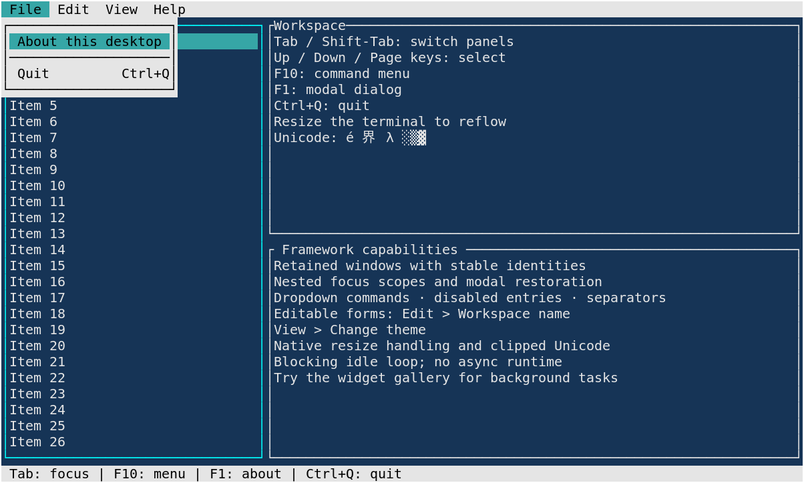
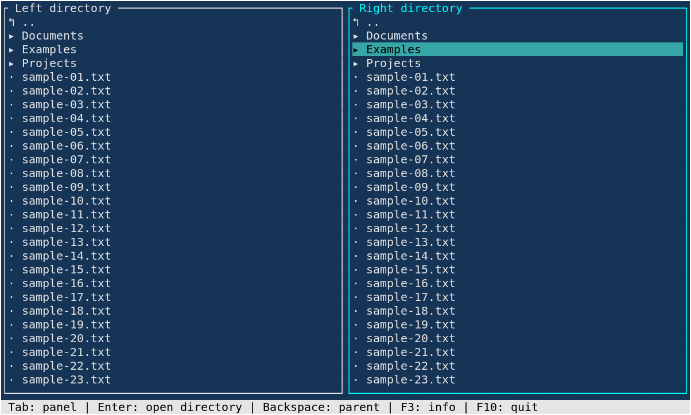
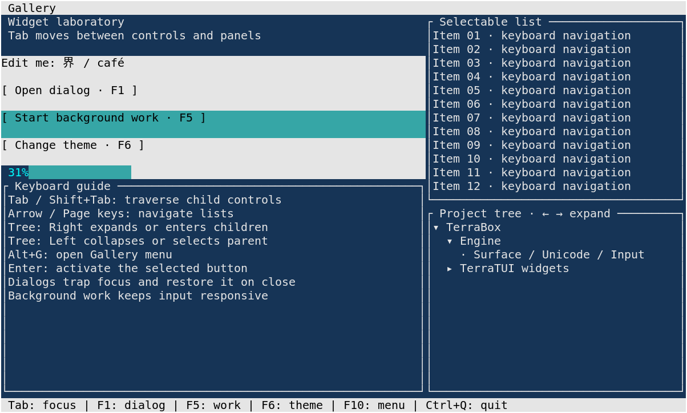
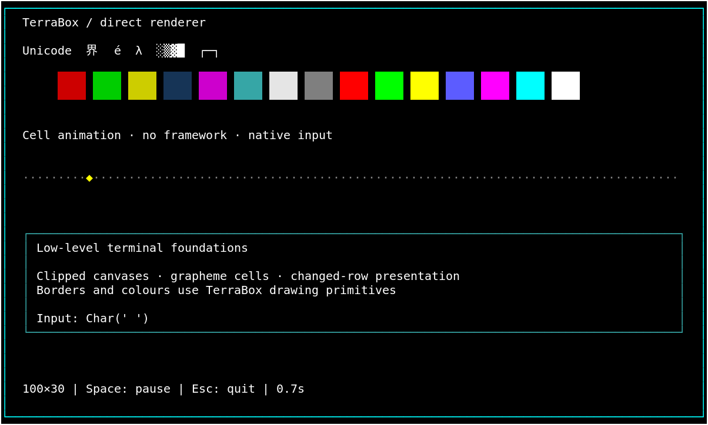

# TerraBox

A lightweight Rust foundation for building cross-platform terminal applications.

**TerraBox** is the rendering and input engine. **TerraTUI** adds retained
widgets, focus, layouts and an application lifecycle. Use either level directly;
no async runtime, ncurses or GUI is required.

| Crate | What it owns |
|---|---|
| [`terrabox`](crates/terrabox) | Terminal restoration, input, Unicode cells, colours, clipped drawing, surfaces and changed-row presentation |
| [`terratui`](crates/terratui) | Applications, commands, nested focus, menus, editable dialogs, lists, trees, progress, status and deadlines |

## Screenshots

Actual running examples, captured in a 100×30 xterm. The file browser uses
sample files in a temporary directory. [Capture instructions](assets/screenshots/README.md).

### TerraTUI desktop



### Read-only dual-panel file browser



### Interactive widget gallery



[Editable modal dialog screenshot](assets/screenshots/terratui-dialog.png).

### TerraBox on its own



## Features

- Native Unix and Windows backends; RAII terminal restoration on return and unwind.
- Grapheme-aware cells, atomic wide-glyph clipping, surfaces and region scrolling.
- Keyboard, mouse, paste and resize input; blocking waits and optional deadlines.
- Nested focus scopes, widget-first key handling, configurable Tab/Shift+Tab,
  modal trapping and restoration of previous focus.
- Dropdown menus with mnemonics, shortcuts, disabled commands and separators.
- Labels, buttons, Unicode text inputs, selectable lists, expandable trees,
  editable dialogs, progress indicators and status bars.
- Nested fixed, weighted and minimum-size splits; collapsed layouts.
- Thread-safe application messages with native wakeups, cancellable timers
  and cooperative worker shutdown. Idle applications have no periodic tick.

## Architecture

```text
Application ───────> TerraBox ───> native terminal
     └──> TerraTUI ────┘
```

TerraBox has no dependency on TerraTUI. Widgets draw to clipped TerraBox canvases;
applications own files, documents and business operations. Rendering runs on
request. Terminal presentation compares changed rows with the previous frame.
The logical desktop frame is rebuilt on redraw; there is no scene cache.

On Unix, terminal operations come from the installed terminfo database first.
A small specification-based VT fallback covers documented compatibility names;
unknown names without a usable entry fail safely. Windows uses its native
backend and documented VT output without requiring terminfo or ncurses.
See [capabilities and provenance](docs/terminal-capability-audit.md).

[Architecture](docs/architecture.md) · [Framework guide](docs/TERRATUI.md) ·
[Engine guide](docs/ENGINE.md)

## Quick Start

Use a recent stable Rust toolchain supporting edition 2024, and run inside a terminal:

```sh
cargo run -p terrabox --example terrabox-demo
cargo run -p terratui --example terratui-desktop
cargo run -p terratui --example terratui-files -- .
cargo run -p terratui --example terratui-widgets
```

For a sibling project, add one of these path dependencies:

```toml
[dependencies]
terrabox = { path = "../terrabox/crates/terrabox" }
# Or use the application framework:
terratui = { path = "../terrabox/crates/terratui" }
```

Start with the beginner examples in the [engine README](crates/terrabox/README.md)
and [framework README](crates/terratui/README.md).

## Examples

| Example | Interaction |
|---|---|
| `terrabox-demo` | Colour swatches, Unicode, clipped borders, moving cells; Space pauses, Escape quits; resize redraws |
| `terratui-desktop` | Tab/Shift+Tab selects panels; F10 or Alt+F/E/V/H opens menus; Edit changes workspace name; View changes theme; F1 shows About; Ctrl+Q quits |
| `terratui-files` | Enter opens a directory, Backspace goes up, arrows/Page/Home/End navigate, Tab switches panels, F3 shows metadata, F10 quits |
| `terratui-widgets` | Tab traverses controls and panels, arrows navigate lists/trees; F1 opens a form, F5 starts background progress, F6 changes theme, Ctrl+Q quits |

Dialogs capture keyboard input: Enter activates a button or the default action;
Escape cancels. Close a modal before using a global quit shortcut. Mouse clicks
select panels, controls and menu commands in the desktop and gallery.
The original `desktop` and focused engine examples remain available.

## Platform Support

Linux has automated PTY and live xterm checks. The current source also passes
Windows GNU cross-target checks; this does **not** verify native Windows console
behavior. Native macOS and Windows runtime validation remain pending. Terminal
font coverage and support for physical key combinations vary.
See the [Phase 2 validation report](docs/phase2-validation.md) for exact checks.

## Development

```sh
cargo fmt --all --check
cargo clippy --workspace --all-targets -- -D warnings
cargo test --workspace
cargo build --workspace
cargo build --workspace --examples
python3 scripts/smoke-examples.py       # Unix PTY checks; Linux idle CPU measurement
cargo run --release -p terrabox --example scroll-bench
```

The scroll workload and [measurements](docs/phase2-validation.md) justify limiting
snapshots to the affected region. No renderer cache or output protocol was added.

## Roadmap

Next: application adoption, native platform testing, scrollbars, richer tree
activation, large-menu scrolling and nested submenus when needed. Floating
windows, graphics and transitions are future work. **Kitty graphics, image
upload/placement and advanced animation are planned, not implemented.** Current
animation uses timed cell drawing. [Roadmap](docs/roadmap.md).

## License

MIT. See [LICENSE](LICENSE) and [dependency notices](THIRD_PARTY_NOTICES.md).
The [capability provenance audit](docs/terminal-capability-audit.md) records the
replacement of the historical adapted tables and the scope of the review.
